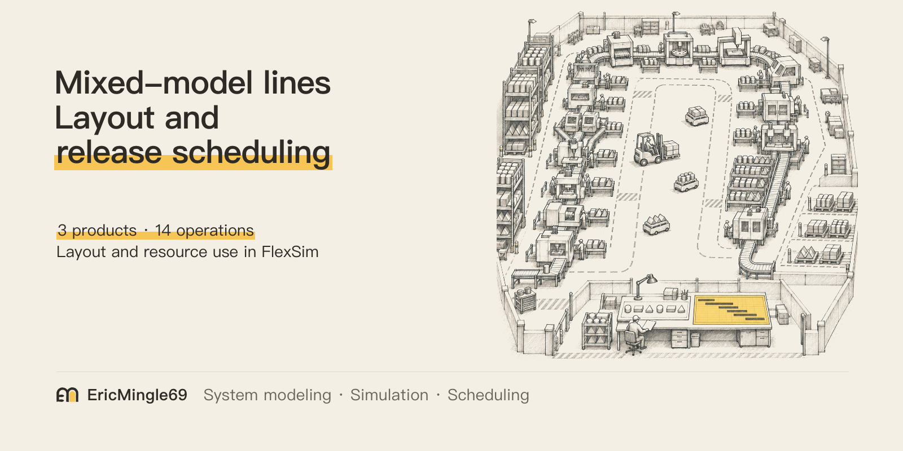
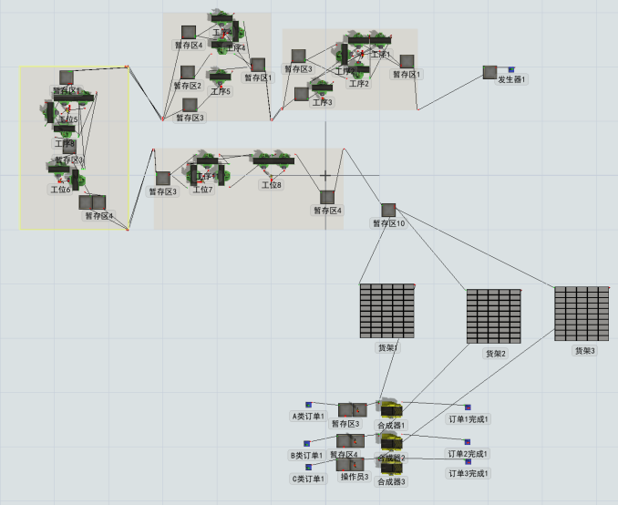
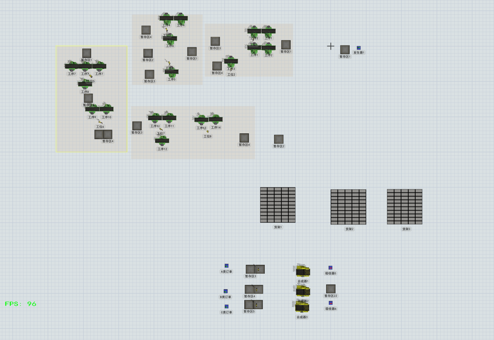
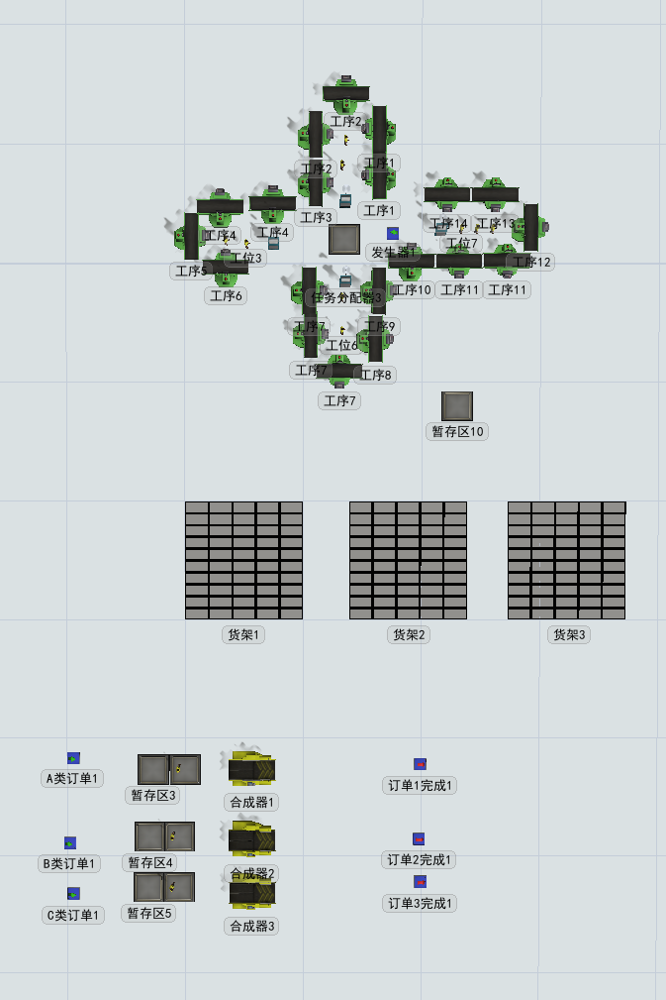

<picture>
  <source media="(prefers-color-scheme: dark)" srcset="readme-assets/cover-en-dark.png">
  
</picture>

  <a href="系统建模项目报告.docx">Report</a> · <a href="任务书.txt">Assignment</a> · <a href="U型.fsm">U-shaped model</a> · <a href="计算公式.txt">Formulas</a>

  
  
  
  

<a href="README.md">简体中文</a> · <strong>English</strong>

# Mixed-model production line design and simulation

This project uses FlexSim to model a production line for products A, B and C across 14 operations. The course work compares linear, U-shaped and flower-shaped (cell layout in the report) layouts, compares release sequences across 6 scenarios, and examines line balance, personnel and equipment utilization, and work in progress.

## Overview

The repository archives three `.fsm` layout models, the assignment, formulas, a report and explanatory images. The assignment focuses on checking Little’s law and comparing production-system performance. Here, `.fsm` denotes a FlexSim model file.

## Design highlights

| Object | Course assumptions and scope |
| --- | --- |
| Products and demand | A, B and C; average daily demand of 80, 80 and 40 units respectively |
| Unit profit | 15, 12 and 20 for A, B and C, on the assignment’s common pricing basis |
| Working time | Three rotating shifts covering 24 hours per day |
| Processing times | Normal distributions; means μ follow the assignment table, with standard deviations σ specified below |
| Operations and equipment | 14 operations; operations 1, 2, 4 and 11 have two machines each, operation 7 has three, and the others have one each |
| Layouts | Linear baseline, with U-shaped and flower-shaped alternatives |
| Scheduling | Release-sequence comparisons across 6 scenarios, with workstation and staffing assignments used to examine waiting; batch-size experiments are required by the assignment but were not conducted in the report |
| Measures | Line balance, personnel and equipment utilization, work in progress, finished inventory and order completion |

Parameter assumptions come from the assignment; completed experiments are distinguished using the report. Processing times are in minutes, with σ=1 for μ≤5, σ=2 for 5<μ≤10, σ=3 for 10<μ≤20, and σ=4 for μ≥20. The original intervals overlap at μ=20, which requires clarification if used. Equipment configurations and order parameters in revised models require separate checks against the models, report and assignment; for example, the report’s product A order-parameter screenshot uses a mean of 40, while the assignment specifies 80.[[1]](#references)

## Results

U-shaped model view from the report:

Linear and flower-shaped model views

These views were extracted from the report and retain the original software display. The report records layout comparisons, release-sequence experiments, resource states and work-in-progress trends; see the [project report](系统建模项目报告.docx) for the charts. The cover is a conceptual factory-scheduling illustration; the model views and `.fsm` files describe the archived models.

## Method

1. The project analyzes capacity from demand, processing times and machine counts, calculates takt time and assigns operations to workstations.
2. The FlexSim models represent production, buffers, transport and order processing in linear, U-shaped and flower-shaped layouts.
3. The report compares 6 release-sequence scenarios over 59 simulated days, with 5 replications per scenario, and selects BBAC based on sales revenue. Line balance, resource states, work in progress and order completion are analyzed separately through model statistics.
4. The report checks Little’s law, `L = λW`, in the report’s idealized case: average work in progress equals average flow rate multiplied by average time in the system. A recheck must use consistent system boundaries, time units and observation intervals.[[2]](#references)

The [assignment](任务书.txt) and [report outline](目录.txt) are the entry points; the models require a compatible FlexSim environment. The original software version, extensions, random seeds, warm-up settings and complete run instructions remain to be documented. There is no unified command-line entry point.

## Limitations

- This is a course archive. Model compatibility and simulation results have not been independently rerun; they do not establish real-factory performance or an optimal layout.
- Some report calculations and wording need review. For example, the processing time used to calculate product A’s bottleneck output differs from the assignment table; this README does not adopt that output claim.
- Batch-size experiments were not completed. The Little’s law check and resource-utilization comparisons still require review under consistent statistical conditions. No automatically reproducible experiment scripts are provided.
- U-shaped layout order results are inconsistent: Section 5.1 reports A/B/C completion rates of 54.2%/57.6%/28.8%, while Section 6.2 reports 17/17/34 completed orders over 59 days. These figures do not provide a consistent basis for quantifying improvement.
- No repository-wide license covers all original models and materials. The documentation license does not change the rights to those materials.

## Acknowledgements

The project retains the assignment, formulas and report as modeling sources and uses FlexSim for production-system modeling. The cover illustration was generated by an image-generation model and processed for this project.

The report lists two production-system modeling textbooks as background sources for modeling and simulation methods.[[3]](#references)[[4]](#references) The official FlexSim user manual supplements the explanation of Experimenter scenarios and replications; its version does not establish the original model version.[[5]](#references)

## References

1. [Mixed-model production line assignment](任务书.txt), [formulas](计算公式.txt) and [project report](系统建模项目报告.docx). Archived course materials supporting the demand, operation, layout and scheduling assumptions.
2. Little, J. D. C. (1961). A Proof for the Queuing Formula: L = λW. *Operations Research*, 9(3), 383–387. [DOI](https://doi.org/10.1287/opre.9.3.383). Original theoretical source for the law used in the assignment, added here without claiming that the report directly cited this paper.

3. Zhou, H., Deng, X., & Gao, D. (2012). *生产系统建模与仿真* [Production System Modeling and Simulation]. China Machine Press. ISBN 9787111393191. [Publisher](https://www.cmpedu.com/books/book/2016686.htm). Listed in the original report; covers production-system modeling and simulation experiment design.
4. Zhu, H. (2022). *生产系统建模与仿真* [Production System Modeling and Simulation]. Tsinghua University Press. ISBN 9787302617327. [Publisher](https://www.tup.tsinghua.edu.cn/booksCenter/book_09681201.html). Listed in the original report; covers simulation principles using FactorySimulation, not the implementation details of this FlexSim project.
5. Autodesk. *FlexSim User Manual*, 2027: The Experimenter. [Official manual](https://help.autodesk.com/view/FLEXSIMIN/2027/ENU/?guid=FlexSim_User_Manual_reference_tools_experimenter_html). Supplementary software reference, not a direct citation from the original report.

## Related research

- Little, J. D. C. (2011). OR FORUM—Little’s Law as Viewed on Its 50th Anniversary. *Operations Research*, 59(3), 536–549. [DOI](https://doi.org/10.1287/opre.1110.0940). Further reading on the relationship between work in progress, flow rate and time in the system, and its application conditions; not an implementation source for the model.

## Repository structure

| File | Contents |
| --- | --- |
| `直线.fsm`, `U型.fsm`, `花型.fsm` | FlexSim models for the three layouts |
| `任务书.txt`, `目录.txt`, `计算公式.txt` | Assignment scope, report outline and formulas |
| `系统建模项目报告.docx` | Modeling process, experiments and discussion |
| `讲解图.zip` | Archived explanatory images |
| `readme-assets/` | Bilingual light/dark covers, report model views and documentation license |
| `PERSONAL-NOTICE.md` | Maintenance attribution and permission boundaries |

---

Documentation maintained by **✦ EricMingle69** · [Ming-Sir-69](https://github.com/Ming-Sir-69)  
License: [MIT for new original documentation and facade assets](readme-assets/PERSONAL-DOCUMENTATION-LICENSE.md); permissions for original models, reports and third-party materials depend on their respective sources.
