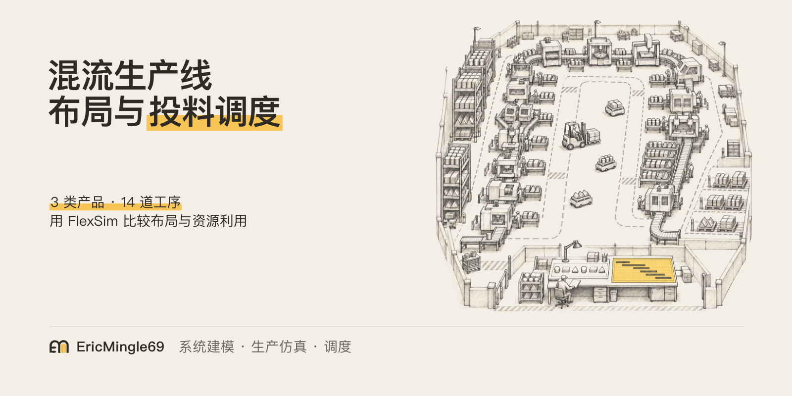
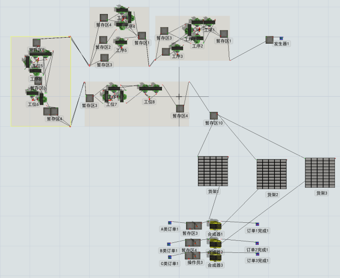
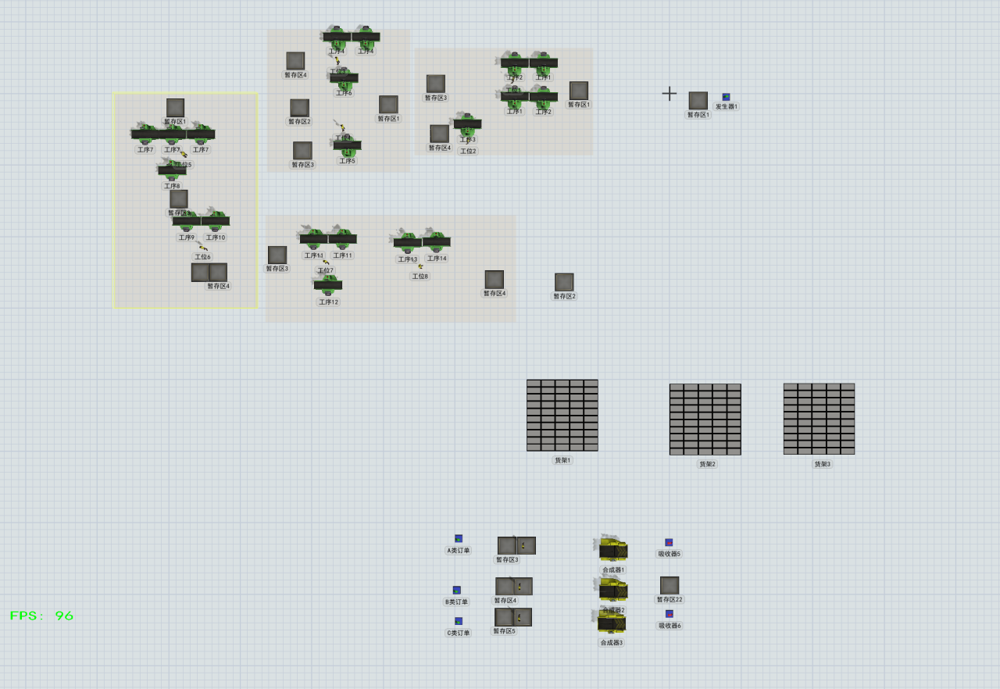
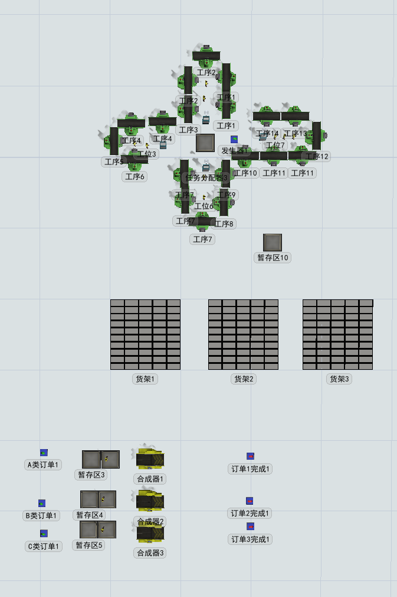

<picture>
  <source media="(prefers-color-scheme: dark)" srcset="readme-assets/cover-zh-dark.png">
  
</picture>

  <a href="系统建模项目报告.docx">项目报告</a> · <a href="任务书.txt">课程任务</a> · <a href="U型.fsm">U 型模型</a> · <a href="计算公式.txt">计算公式</a>

  
  
  
  

<strong>简体中文</strong> · <a href="README.en.md">English</a>

# 混流生产线设计与仿真

本项目使用 FlexSim 对 A、B、C 三种产品的混流生产线进行课程建模，覆盖 14 道工序，比较直线型、U 型与花型（报告称单元布局）布局，比较投料顺序（6 个方案），并分析产线平衡、人员及设备利用率和在制品。

## 概述

仓库保存三种布局的 `.fsm` 模型、课程任务、计算公式、项目报告和讲解图。课题以利特尔法则验证与生产系统性能比较为主线。这里的 `.fsm` 是 FlexSim 模型文件。

## 设计要点

| 对象 | 课程设定与分析范围 |
| --- | --- |
| 产品与需求 | A、B、C 三种产品；平均日需求分别为 80、80、40 件 |
| 单件利润 | A、B、C 分别为 15、12、20，按任务书相同计价口径 |
| 工作时间 | 三班轮换，全天 24 小时 |
| 加工时间 | 正态分布；均值 μ 取任务表，标准差 σ 规则见下文 |
| 工艺与设备 | 14 道工序；工序 1、2、4、11 各有两台设备，工序 7 有三台，其余各一台 |
| 布局 | 直线型基准方案，以及 U 型、花型改善方案 |
| 调度 | 比较投料顺序（6 个方案），结合工位分配和人员配置分析等待；批量为任务书要求，报告未开展该实验 |
| 评价指标 | 产线平衡、人员与设备利用率、在制品、成品库存及订单完成情况 |

参数设定取自任务书；实验范围按报告区分。加工时间以分钟计，标准差规则为：μ≤5 时 σ=1，5<μ≤10 时 σ=2，10<μ≤20 时 σ=3，μ≥20 时 σ=4。原规则在 μ=20 处重叠，使用该边界值时需核对。改善模型的设备配置与订单参数需分别核对模型、报告及任务书；例如报告 A 类订单参数截图的均值为 40，任务书为 80。[[1]](#参考文献)

## 成果展示

报告中的 U 型方案模型视图：

直线型与花型模型视图

模型视图提取自原报告，保留软件原始显示。报告记录了布局比较、投料顺序实验、资源状态和在制品变化；具体图表见[项目报告](系统建模项目报告.docx)。封面为车间调度概念插画，实际模型以本节视图及 `.fsm` 文件为准。

## 方法

1. 根据需求、加工时间及设备台数分析产能，计算节拍并分配工位作业。
2. 在 FlexSim 中建立生产、暂存、运输与订单处理逻辑，保存直线型、U 型和花型布局。
3. 比较投料顺序（6 个方案），模拟 59 天、每方案重复 5 次。报告按销售额选出 BBAC 顺序；工位平衡、资源状态、在制品和订单完成情况另由模型统计分析。
4. 在报告的理想状态案例中核对利特尔法则 `L = λW`：平均在制品量等于平均流率与平均停留时间的乘积；复核时需统一系统边界、时间单位和统计区间。[[2]](#参考文献)

[课程任务](任务书.txt)与[报告目录](目录.txt)为入口文件，模型需在兼容的 FlexSim 环境中打开。模型原始版本、扩展依赖、随机种子、预热设置及完整运行步骤尚待整理；仓库没有统一命令行入口。

## 局限

- 本项目是课程成果归档，模型兼容性和仿真结果尚未独立复跑，不能据此推断现实工厂性能或确定最优布局。
- 报告存在待复核的计算与文字口径。例如，A 产品瓶颈产量计算使用的加工时间与任务表不一致，正文不采用该产量结论。
- 投料批量实验未完成。利特尔法则检验及资源利用率比较仍需在一致的统计条件下复核；仓库未提供可自动复现的实验脚本。
- U 型方案的订单结果前后不一致：第 5.1 节给出 A/B/C 完成率 54.2%/57.6%/28.8%，第 6.2 节给出 59 天内完成 17/17/34 份，不能直接据此确定改善幅度。
- 仓库没有覆盖全部原始模型与资料的统一许可证；新增文档许可不改变原材料的授权范围。

## 致谢

本项目保留课程任务、公式资料与报告作为建模来源，使用 FlexSim 完成生产系统模型。封面插画由图像生成模型生成，经本项目处理。

报告书目列有两本生产系统建模教材，对应建模与仿真方法背景。[[3]](#参考文献)[[4]](#参考文献) FlexSim 官方用户手册用于补充实验器的场景与重复运行说明；文档版本不代表原模型版本。[[5]](#参考文献)

## 参考文献

1. [混流生产线设计与仿真课程任务](任务书.txt)、[计算公式](计算公式.txt)与[项目报告](系统建模项目报告.docx)。仓库内课程资料；对应需求、工序、布局与调度设定。
2. Little, J. D. C. (1961). A Proof for the Queuing Formula: L = λW. *Operations Research*, 9(3), 383–387. [DOI](https://doi.org/10.1287/opre.9.3.383)。对应课题使用的利特尔法则；此处补充原始理论出处，不表示原报告曾直接引用该论文。

3. 周泓、邓修权、高德华（2012）.《生产系统建模与仿真》. 机械工业出版社. ISBN 9787111393191. [出版社](https://www.cmpedu.com/books/book/2016686.htm)。原报告所列教材，涵盖生产系统建模与仿真实验设计。
4. 朱海平（2022）.《生产系统建模与仿真》. 清华大学出版社. ISBN 9787302617327. [出版社](https://www.tup.tsinghua.edu.cn/booksCenter/book_09681201.html)。原报告所列教材，讨论生产系统仿真原理；书中软件为 FactorySimulation，不据此认定本项目的 FlexSim 实现细节。
5. Autodesk. *FlexSim User Manual*, 2027: The Experimenter. [官方手册](https://help.autodesk.com/view/FLEXSIMIN/2027/ENU/?guid=FlexSim_User_Manual_reference_tools_experimenter_html)。补充软件实验器说明，非原报告直接引文。

## 相关研究

- Little, J. D. C. (2011). OR FORUM—Little’s Law as Viewed on Its 50th Anniversary. *Operations Research*, 59(3), 536–549. [DOI](https://doi.org/10.1287/opre.1110.0940)。对应在制品、流率与停留时间的关系及应用条件，作为延伸阅读，不作为本模型实现依据。

## 仓库结构

| 文件 | 内容 |
| --- | --- |
| `直线.fsm`、`U型.fsm`、`花型.fsm` | 三种布局的 FlexSim 模型 |
| `任务书.txt`、`目录.txt`、`计算公式.txt` | 课程范围、报告结构与公式资料 |
| `系统建模项目报告.docx` | 建模过程、实验与讨论 |
| `讲解图.zip` | 原有讲解图归档 |
| `readme-assets/` | 中英亮暗封面、报告模型视图及文档许可 |
| `PERSONAL-NOTICE.md` | 维护署名与权限边界 |

---

文档维护：**✦ EricMingle69** · [Ming-Sir-69](https://github.com/Ming-Sir-69)  
许可：[新增原创文档与门面素材采用 MIT](readme-assets/PERSONAL-DOCUMENTATION-LICENSE.md)；原模型、报告及第三方资料按各自来源确认权限。
